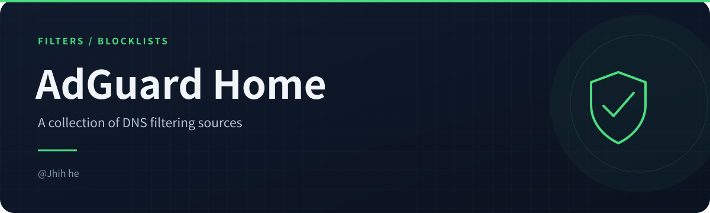
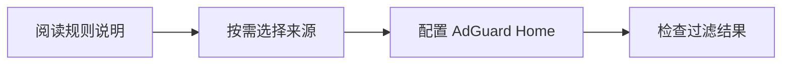

<!-- readme-visuals:header:start -->

  
  
  

<!-- readme-visuals:header:end -->

# 🛡️ AdGuard Home Filters Blocklists

> 全网最全面的 AdGuard Home 过滤规则集合，累计收录近 **200万条** 规则

<!-- readme-visuals:overview:start -->

## 项目速览

<table>
<tr>
<td width="33%"><strong>规则集合</strong>  汇集多来源 DNS 过滤规则。</td>
<td width="33%"><strong>多种分类</strong>  广告、隐私及恶意域名相关列表。</td>
<td width="33%"><strong>手动配置</strong>  按需选择规则并配置 AdGuard Home。</td>
</tr>
</table>

### 流程概览

<!-- readme-visuals:overview:end -->

## 📦 特性亮点

- ✅ 整合 **30+** 个优质过滤规则源
- 🌍 覆盖多国地区（中国、印尼、伊朗、意大利等）
- 🛡️ 包含广告过滤、隐私保护、恶意网站拦截等分类
- 🔄 持续维护更新，兼容 OpenWrt 等主流平台

## 🚀 快速开始

### 手动配置（推荐）
1. 登录 OpenWrt AdGuard Home 管理界面
2. 定位到 `手动设置` -> `filters:` 配置段
3. 复制以下配置内容插入到指定位置：

filters:
- enabled: true
  url: https://adguardteam.github.io/AdGuardSDNSFilter/Filters/filter.txt
  name: AdGuard DNS filter
  id: 1
- enabled: true
  url: https://adaway.org/hosts.txt
  name: AdAway Default Blocklist
  id: 2
- enabled: true
  url: https://www.malwaredomainlist.com/hostslist/hosts.txt
  name: MalwareDomainList.com Hosts List
  id: 4
- enabled: true
  url: https://someonewhocares.org/hosts/zero/hosts
  name: Dan Pollock's List
  id: 1615971106
- enabled: true
  url: https://raw.githubusercontent.com/Perflyst/PiHoleBlocklist/master/SmartTV-AGH.txt
  name: Perflyst and Dandelion Sprout's Smart-TV Blocklist
  id: 1615971107
- enabled: true
  url: https://raw.githubusercontent.com/DandelionSprout/adfilt/master/GameConsoleAdblockList.txt
  name: Game Console Adblock List
  id: 1615971108
- enabled: true
  url: https://pgl.yoyo.org/adservers/serverlist.php?hostformat=adblockplus&showintro=1&mimetype=plaintext
  name: Peter Lowe's List
  id: 1615971109
- enabled: true
  url: https://raw.githubusercontent.com/crazy-max/WindowsSpyBlocker/master/data/hosts/spy.txt
  name: WindowsSpyBlocker - Hosts spy rules
  id: 1615971110
- enabled: true
  url: https://raw.githubusercontent.com/hoshsadiq/adblock-nocoin-list/master/hosts.txt
  name: NoCoin Filter List
  id: 1615971111
- enabled: true
  url: https://raw.githubusercontent.com/durablenapkin/scamblocklist/master/adguard.txt
  name: Scam Blocklist by DurableNapkin
  id: 1615971112
- enabled: true
  url: https://raw.githubusercontent.com/Spam404/lists/master/main-blacklist.txt
  name: Spam404
  id: 1615971113
- enabled: true
  url: https://raw.githubusercontent.com/mitchellkrogza/The-Big-List-of-Hacked-Malware-Web-Sites/master/hosts
  name: The Big List of Hacked Malware Web Sites
  id: 1615971114
- enabled: true
  url: https://curben.gitlab.io/malware-filter/urlhaus-filter-agh-online.txt
  name: Online Malicious URL Blocklist
  id: 1615971115
- enabled: true
  url: https://anti-ad.net/easylist.txt
  name: 'CHN: anti-AD'
  id: 1615971116
- enabled: true
  url: https://raw.githubusercontent.com/ABPindo/indonesianadblockrules/master/subscriptions/abpindo.txt
  name: 'IDN: ABPindo'
  id: 1615971117
- enabled: true
  url: https://raw.githubusercontent.com/DRSDavidSoft/additional-hosts/master/domains/blacklist/unwanted-iranian.txt
  name: 'IRN: Unwanted Iranian domains'
  id: 1615971118
- enabled: true
  url: https://filtri-dns.ga/filtri.txt
  name: 'ITA: Filtri-DNS'
  id: 1615971119
- enabled: true
  url: https://raw.githubusercontent.com/yous/YousList/master/hosts.txt
  name: 'KOR: YousList'
  id: 1615971120
- enabled: true
  url: https://raw.githubusercontent.com/cchevy/macedonian-pi-hole-blocklist/master/hosts.txt
  name: 'MKD: Macedonian Pi-hole Blocklist'
  id: 1615971121
- enabled: true
  url: https://raw.githubusercontent.com/DandelionSprout/adfilt/master/NorwegianExperimentalList%20alternate%20versions/NordicFiltersAdGuardHome.txt
  name: 'NOR: Dandelion Sprouts nordiske filtre'
  id: 1615971122
- enabled: true
  url: https://raw.githubusercontent.com/MajkiIT/polish-ads-filter/master/polish-pihole-filters/hostfile.txt
  name: 'POL: Polish filters for Pi hole'
  id: 1615971123
- enabled: true
  url: https://raw.githubusercontent.com/lassekongo83/Frellwits-filter-lists/master/Frellwits-Swedish-Hosts-File.txt
  name: 'SWE: Frellwit''s Swedish Hosts File'
  id: 1615971124
- enabled: true
  url: https://abpvn.com/android/abpvn.txt
  name: 'VNM: ABPVN List'
  id: 1615971126
- enabled: true
  url: https://paulgb.github.io/BarbBlock/blacklists/hosts-file.txt
  name: BarbBlock
  id: 1615971127
- enabled: true
  url: https://gitee.com/halflife/list/raw/master/ad.txt
  name: halflife
  id: 1615971129
- enabled: true
  url: https://gitee.com/xinggsf/Adblock-Rule/raw/master/rule.txt
  name: xinggsf
  id: 1615971130
- enabled: true
  url: http://sub.adtchrome.com/adt-chinalist-easylist.txt
  name: ChinaList+EasyList
  id: 1615971131
- enabled: true
  url: https://raw.githubusercontent.com/cjx82630/cjxlist/master/cjx-annoyance.txt
  name: 'CJX’s Annoyance List : 过滤烦人的自我推广，并补充 EasyPrivacy 隐私规则。'
  id: 1615971133
- enabled: true
  url: https://gitee.com/xinggsf/Adblock-Rule/raw/master/mv.txt
  name: xinggsf，乘风广告过滤规则 + 视频过滤规则
  id: 1615971134
- enabled: true
  url: https://gitee.com/cjx82630/cjxlist/raw/master/cjx-annoyance.txt
  name: ChinaList+EasyList2
  id: 1615971135
- enabled: true
  url: https://cdn.jsdelivr.net/gh/privacy-protection-tools/anti-AD@master/anti-ad-easylist.txt
  name: /anti-AD
  id: 1615971136
- enabled: true
  url: https://raw.githubusercontent.com/privacy-protection-tools/anti-AD/master/anti-ad-easylist.txt
  name: antiad
  id: 1615971137
- enabled: true
  url: https://raw.githubusercontent.com/Goooler/1024_hosts/master/hosts
  name: 1024 网站及澳门皇家赌场及恶意广告主机列表
  id: 1615971138
- enabled: true
  url: http://winhelp2002.mvps.org/hosts.txt
  name: winhelp2002
  id: 1615971141
- enabled: true
  url: https://easylist-downloads.adblockplus.org/easyprivacy.txt
  name: EasyPrivacy
  id: 1615971142
- enabled: true
  url: https://www.i-dont-care-about-cookies.eu/abp/
  name: EasyList Cookie List
  id: 1615971144
- enabled: true
  url: https://raw.githubusercontent.com/zsakvo/AdGuard-Custom-Rule/master/rule/zhihu.txt
  name: zhihu1
  id: 1615971145
- enabled: true
  url: https://raw.githubusercontent.com/zsakvo/AdGuard-Custom-Rule/master/rule/zhihu-strict.txt
  name: zhihu2
  id: 1615971146
- enabled: true
  url: https://raw.githubusercontent.com/jdlingyu/ad-wars/master/hosts
  name: 1024adgway
  id: 1615971147
- enabled: true
  url: https://raw.githubusercontent.com/googlehosts/hosts/master/hosts-files/hosts
  name: Google hosts
  id: 1615971148
- enabled: true
  url: https://hblock.molinero.dev/hosts
  name: Hblock
  id: 1615971149
- enabled: true
  url: https://cdn.jsdelivr.net/gh/neoFelhz/neohosts@gh-pages/basic/hosts.txt
  name: Mvps
  id: 1615971150
- enabled: true
  url: https://cdn.jsdelivr.net/gh/neoFelhz/neohosts@gh-pages/full/hosts.txt
  name: neoFelhz
  id: 1615971151
- enabled: true
  url: http://sub.adtchrome.com/adt-chinalist-easylist360.txt
  name: adt-chinalist-easylist360
  id: 1615972257
- enabled: true
  url: https://gitee.com/banbendalao/adguard/raw/master/ADgk.txt
  name: adgk 手机去广告规则
  id: 1615972258
- enabled: true
  url: https://raw.githubusercontent.com/vokins/yhosts/master/hosts
  name: yhosts - 屏蔽国内网站广告 - 国内维护
  id: 1615972259
- enabled: true
  url: https://www.kbsml.com/wp-content/uploads/adblock/adguard/adg-kall.txt
  name: adg-kall
  id: 1615972262
- enabled: true
  url: https://raw.githubusercontent.com/neodevpro/neodevhost/master/adblocker
  name: jhihhe
  id: 1615972266
- enabled: true
  url: https://raw.githubusercontent.com/uniartisan/adblock_list/master/adblock.txt
  name: adblock
  id: 1615972267
- enabled: true
  url: https://raw.githubusercontent.com/uniartisan/adblock_list/master/adblock_lite.txt
  name: adblock2
  id: 1615972268
- enabled: true
  url: https://raw.githubusercontent.com/uniartisan/adblock_list/master/adblock_plus.txt
  name: adblock3
  id: 1615972269
- enabled: true
  url: https://raw.githubusercontent.com/uniartisan/adblock_list/master/adblock_privacy.txt
  name: adblock4
  id: 1615972270
- enabled: true
  url: https://raw.githubusercontent.com/BlueSkyXN/AdGuardHomeRules/master/all.txt
  name: all
  id: 1615972271
